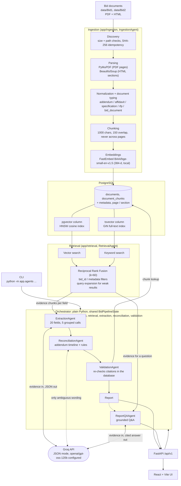

# Helix architecture

The diagram below is the same source as [`architecture.mmd`](architecture.mmd) (Mermaid; GitHub and VS Code render it). A pre-rendered PNG is not included because no Mermaid renderer could be run in the environment this was prepared in.

## How the pieces talk to each other

- **Everything is in-process Python.** The agents are plain classes called in order by `Orchestrator` (`backend/app/agents/orchestrator.py`); they share one `BidPipelineState` object. There is no message bus, queue or agent framework.
- **PostgreSQL is the only store.** Ingestion writes `documents` and `document_chunks` (text, page or HTML section, metadata, a 384-d `vector` column with an HNSW cosine index, and a generated `tsvector` column with a GIN index). Retrieval and the Validation agent read from it.
- **Retrieval** runs vector and keyword search separately, fuses them with Reciprocal Rank Fusion (k=60), and always filters by `bid_id`, which is what keeps Bid1 and Bid2 isolated. No reranker is implemented.
- **Groq is called only by three components**, always through the single `GroqClient` (`backend/app/llm/groq_client.py`): extraction (5 grouped calls per bid), reconciliation (only for ambiguous change wording; explicit wording is handled by deterministic rules) and Q&A. The model receives evidence chunks and returns JSON (extraction) or a cited answer (Q&A); the application rebuilds citations from the stored chunks and never trusts model-written citations.
- **The Validation agent** re-reads every cited chunk from PostgreSQL and checks that it exists, belongs to the bid, matches its file and page, and contains the value. A report is only returned when validation passes.
- **Entry points:** the FastAPI app (`/api/v1/...`, used by the React UI) and the CLI (`python -m app.agents BID`, plus per-stage modules). Both call the same orchestrator and services.
